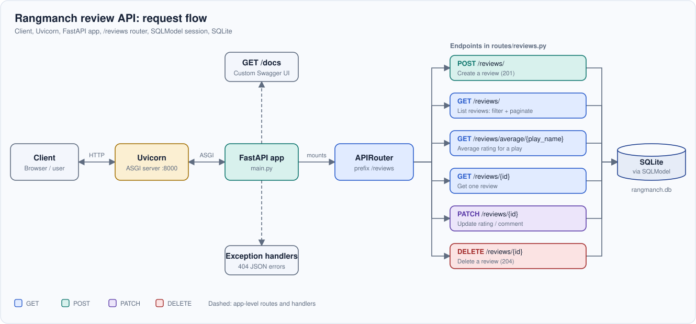

<p align="center">
  
</p>

<p align="center">
  
  
  
  
  
</p>

# Rangmanch Review API

A theatre customer-review API for a Hyderabad-based theatre startup. Audiences can post a rating and a comment for a play, and the team can list reviews, look up a single review, and see the average rating for any play.

The project is deliberately small. It is meant to show how a clean, readable FastAPI service looks when it is built the production way, without extra layers.

## Highlights

- **Clean, simple, production-grade code and API design.** Resource-oriented URLs, separate schemas for create / read / update, correct HTTP status codes, dependency-injected database sessions, and consistent JSON errors.
- **SQLite through SQLModel.** One class defines both the table and the validation rules. Tables are created at startup, so there is nothing to set up by hand.
- **Custom Swagger UI.** The default `/docs` page is replaced by a themed interface with light and dark modes, an endpoint sidebar, and motion that respects `prefers-reduced-motion`. It is plain CSS plus a small script; Swagger's own JavaScript is untouched.
- **Architecture diagram in draw.io.** The full request path, from client to database, is drawn in [`docs/architecture.drawio`](docs/architecture.drawio).
- **Runs with [uv](https://docs.astral.sh/uv/).** A fast, Rust-based replacement for `pip`. One command installs everything.

## Architecture

A request travels from the client (browser or user) to Uvicorn, which serves the FastAPI app. The app mounts the `/reviews` router, and each of the router's endpoints talks to SQLite through a SQLModel session.

<p align="center">
  
</p>

The editable source is [`docs/architecture.drawio`](docs/architecture.drawio). Open it at [app.diagrams.net](https://app.diagrams.net) or in the draw.io desktop app.

## Getting started

### 1. Install uv

```bash
# macOS / Linux
curl -LsSf https://astral.sh/uv/install.sh | sh

# Windows (PowerShell)
powershell -ExecutionPolicy ByPass -c "irm https://astral.sh/uv/install.ps1 | iex"
```

Other install options are listed in the [uv documentation](https://docs.astral.sh/uv/getting-started/installation/).

### 2. Clone and install

```bash
git https://github.com/Zain-Ahma12/Rangmanch-Review-api.git

cd Rangmanch-Review-api
```

### 3. Create virtual environment and install dependencies

```bash
uv venv .venv

.venv\Scripts\activate

uv pip install requirements.txt
```

### 4. Run the server

```bash
python main.py
```

This starts Uvicorn on `http://127.0.0.1:8000` with auto-reload.


Open **http://127.0.0.1:8000/docs** to try the API. The SQLite file `rangmanch.db` is created on first start, so keep it out of version control by adding it to `.gitignore`.


## API endpoints

All review endpoints live under the `/reviews` prefix.

| Method | Path | Description | Success |
| --- | --- | --- | --- |
| `POST` | `/reviews/` | Create a review | `201 Created` |
| `GET` | `/reviews/` | List reviews. Optional `play_name` filter, `skip` and `limit` for pagination | `200 OK` |
| `GET` | `/reviews/average/{play_name}` | Average rating and review count for one play | `200 OK` |
| `GET` | `/reviews/{id}` | Get one review by id | `200 OK` |
| `PATCH` | `/reviews/{id}` | Update the rating and/or comment of a review | `200 OK` |
| `DELETE` | `/reviews/{id}` | Delete a review | `204 No Content` |

Interactive documentation is served at `/docs`, and the raw OpenAPI schema at `/openapi.json`.

### Data model

| Field | Type | Rules |
| --- | --- | --- |
| `id` | integer | Set by the database |
| `play_name` | string | Required, indexed for fast filtering |
| `reviewer_name` | string | Required |
| `rating` | integer | Required, from 0 to 5 |
| `comment` | string | Required |
| `created_at` | datetime (UTC) | Set by the server |

## Custom Swagger UI

FastAPI's `/docs` page is Swagger UI. This project keeps Swagger's own JavaScript exactly as FastAPI generates it, and wraps it with a custom skin in [`docs_ui.py`](custom_docs_ui/docs_ui.py):

- Light and dark themes, remembered between visits and following your system setting until you choose
- A sidebar listing every endpoint, with the active one highlighted as you scroll
- A search box that jumps straight to an endpoint (press `/` to focus it)
- Colour-coded method badges for `GET`, `POST`, `PATCH` and `DELETE`
- Subtle motion, switched off automatically when `prefers-reduced-motion` is set
- A responsive layout that turns the sidebar into a drawer on small screens

The page loads Swagger UI and its fonts from a CDN, so it needs an internet connection. Swagger UI is pinned to one version in `docs_ui.py` because the CSS targets its markup.

### Demo Video

<p align="center">
  <video src="docs/Swagger_ui_show.mp4" controls autoplay loop muted width="100%"></video>

</p>


## Project structure

```text
.
├── main.py              # App factory: lifespan, exception handlers, router, docs
├── database.py          # SQLite engine, table creation, session dependency
├── model.py             # SQLModel table and the Create / Read / Update / Average schemas
├── docs_ui.py           # Custom Swagger UI (CSS + small script)
├── routes/
│   └── reviews.py       # The /reviews router: all six endpoints
├── exceptions/
│   └── exceptions.py    # Domain errors and their JSON 404 handlers
├── docs/
│   ├── banner.svg
│   ├── architecture.svg
│   └── architecture.drawio
├── pyproject.toml       # Project metadata and dependencies (used by uv)
├── CONTRIBUTING.md
└── LICENSE
```

## Design principles

- **One job per file.** Routing, data models, database access and error handling each have their own module.
- **Schemas match the use case.** `ReviewCreate`, `ReviewRead` and `ReviewUpdate` keep the server in control of fields like `id` and `created_at`.
- **The database session is a dependency.** Each request gets its own session through `Depends(get_session)`, and it is closed automatically.
- **Errors are data.** Handlers return a stable `error` code, so clients never parse message text.
- **Pagination has limits.** `limit` is capped at 50 so no single request can pull the whole table.

## Contributing

Contributions are welcome. Please read [CONTRIBUTING.md](CONTRIBUTING.md) for the code style, the API design rules and the documentation standards before opening a pull request.

## License

Released under the [MIT License](LICENSE).
